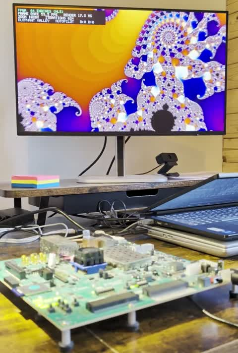

# ZCU102 Fractal Explorer

**A real-time Mandelbrot and Julia explorer for the AMD Zynq UltraScale+ ZCU102 board:
1920×1080 at up to 60 frames per second, zoomable to 4,000,000×, computed by 64 parallel
engines generated with Vitis HLS, displayed over the DisplayPort output of the processing
system.**

The whole design (HLS kernel, Vivado block design, bare-metal software, boot image and this
documentation) was developed by an AI coding agent (Claude, with the AMD "Ross" agentic AI
skills for Vivado/Vitis) together with Sören Richter, who tested on the board and made the
decisions, in three days gross and about three hours net (Sören's time). See [docs/DEVELOPMENT_JOURNEY.md](docs/DEVELOPMENT_JOURNEY.md)
for the full story.

<p align="center">
  <a href="media/demo.mp4"></a><br>
  <em>Click the image for the video (3 min, with the sound of the board).</em>
</p>

## Why this is remarkable

A Mandelbrot image is the textbook example of a workload that is *hard* for hardware:

- **Every pixel is a loop of unknown length.** A pixel is iterated `z → z² + c` until it
  escapes or a limit is reached: some pixels need 1 iteration, their neighbours 1024. One
  1080p frame at deep zoom is around a billion fixed-point multiply-adds, and the work per
  pixel is completely unpredictable.
- **Each iteration depends on the previous one.** The result of one multiplication feeds the
  next, so a naive hardware pipeline can only start a new iteration every few clock cycles.
  The first, naive HLS version reached about **0.5 frames per second** at 1080p.
- **The display does not wait.** 60 fps means the complete frame, two million pixels, has to
  be computed and written to DDR memory in less than 16.7 ms, every frame, while zooming.

The final design runs **64 compute engines with 8 interleaved pixels each** (512 pixels in
flight) at 250 MHz, every engine completing one iteration per clock cycle. Work is balanced
dynamically: as soon as a pixel finishes, its slot takes the next pixel of the row. On top of
that, mathematical shortcuts skip work that provably does not change the image (interior
test for the main cardioid and bulb, periodicity detection for orbits that cycle).

| | ARM Cortex-A53 (1 core, -O2) | FPGA kernel (64 engines) |
|---|---|---|
| Overview, zoom ~50, 432 iterations | ~10 s per frame | **~9 ms per frame (60 fps)** |
| Deep zoom ~10⁶×, 1024 iterations | ~6.6 s per frame | 9–97 ms per frame |
| Speed-up | | **roughly 1000× at the same view** |

Both paths compute the identical algorithm in identical fixed-point arithmetic and produce
bit-identical images; flip DIP switch 2 to watch the CPU paint the same frame line by line.

Measured on the board while flying through the zoom targets (1920×1080):

| Zoom range | Average fps | Slowest frame |
|---|---|---|
| below 1,000× | 54 | 17 fps |
| 1,000× – 100,000× | 51 | 14 fps |
| 100,000× – 1,000,000× | 41 | 11 fps |
| above 1,000,000× (up to 4,000,000×) | 30 | 9 fps |

At 4,000,000× the visible width of the image is less than one millionth of the overview,
which needs 40-bit fixed-point coordinates (Q4.36) throughout the kernel.

## Quick start (prebuilt, no tools needed)

You need: a ZCU102 board, an SD card (FAT32), a DisplayPort monitor that supports 1080p.

1. Copy [prebuilt/BOOT.BIN](prebuilt/BOOT.BIN) to the root directory of the SD card.
2. With the board switched off, set the boot mode switch **SW6 to SD: 1 = ON, 2 = OFF,
   3 = OFF, 4 = OFF**.
3. Insert the card, connect the monitor to the DisplayPort connector, switch on.

After a few seconds the autopilot starts flying through the zoom targets. Optional: the
serial console (USB-UART, first of the four ports, 115200 8N1) prints the link status and
a measurement line every 2 seconds.

## Controls

**Push buttons** (the five buttons arranged as a cross):

| Button | Action |
|---|---|
| Up / down / left / right (SW8 / SW6 / SW4 / SW7) | Pan the image (switches the autopilot off) |
| Hold centre (SW5) + up / down | Zoom in / zoom out |
| Hold centre + left / right | Previous / next zoom target |
| Tap centre briefly | Autopilot on / off |

**DIP switches** (the 8-way user DIP switch, switch 1 to 8):

| DIP | Function |
|---|---|
| 1 | Julia set instead of Mandelbrot set |
| 2 | Compute on the ARM CPU instead of the FPGA (CPU comparison) |
| 3 | Colour animation |
| 4 | Hide the overlay (HUD) |
| 5 + 6 | Iteration limit (switch 5 switch 6, 1 = ON): 00 = automatic (grows with zoom); 10 = 256; 01 = 512; 11 = 1024 |
| 7 | Animate the Julia constant (morphing; slows down the deeper you zoom) |
| 8 | unused |

**What you see:** the overlay shows the compute engine (FPGA or CPU), the frame rate, the
render time of the current frame, the zoom factor, the iteration limit, the zoom target and
whether the autopilot is active. The autopilot zooms into a target up to the maximum zoom,
back out and on to the next one: Seahorse Valley, Elephant Valley, Spiral, Mini Mandelbrot,
Double Spiral. In Julia mode it zooms towards a point that always lies on the Julia set
(a pre-image of the repelling fixed point), even while the constant morphs.

**LEDs:** the user LEDs show frame activity, FPGA/CPU mode, DisplayPort link and autopilot
state (their order on the board has not been verified).

## Hardware and display requirements

- ZCU102 evaluation board (XCZU9EG); the design uses the Vivado board files
  `zcu102:part0:3.4`.
- DisplayPort monitor. The design uses two DisplayPort lanes at HBR (2.7 Gbit/s per lane),
  which carries 1920×1080 at 60 Hz. With only one usable lane it falls back to 1280×720.
  The PCIe slot is not usable in this configuration (GTR lane 0 is switched to DisplayPort).

## Repository layout

```
hls/        HLS kernel: src/ (kernel + shared definitions), tb/ (testbench with bit-exact
            golden model), hls_config.cfg, ip/ (packaged IP used by Vivado)
vivado/     create_project.tcl (recreates the project), system_bd.tcl (block design)
sw/         src/ (bare-metal application), build_sw.py (platform, app, BOOT.BIN),
            run_board.tcl (load via JTAG)
prebuilt/   BOOT.BIN, hardware platform (XSA), boot.bif
tools/      serial console logger, PPM to PNG converter
docs/       development journey, effort estimate, time logs (German original + English)
media/      demo video
```

## Rebuilding from source

Tools: AMD Vivado and Vitis **2026.1.1** (other versions will likely need small changes).
All commands run from the repository root; all outputs go to `build/` (ignored by git).

1. **HLS kernel (optional, the packaged IP is included in `hls/ip/`)**
   ```
   cd hls
   vitis-run --mode hls --csim    --config hls_config.cfg --work_dir fractal
   v++ --compile --mode hls       --config hls_config.cfg --work_dir fractal
   vitis-run --mode hls --cosim   --config hls_config.cfg --work_dir fractal
   vitis-run --mode hls --package --config hls_config.cfg --work_dir fractal
   ```
   C simulation compares the kernel against the golden model on six views and must print
   `TEST PASSED`. Synthesis takes ~10 min; co-simulation of the 64-engine kernel takes
   ~5 hours. Copy `fractal/hls/impl/ip/soenet_demo_fractal_1_0.zip` to `hls/ip/` to use it.
2. **Bitstream and hardware platform (2–3 hours; 166 min on a laptop with i5-13420H)**
   ```
   vivado -mode batch -source vivado/create_project.tcl
   ```
   Produces `build/fractal_zcu102.xsa`.
3. **Software and BOOT.BIN (~5 minutes)**
   ```
   vitis -s sw/build_sw.py
   ```
   Uses `build/fractal_zcu102.xsa` or, if you skipped step 2, `prebuilt/fractal_zcu102.xsa`.
   Produces `build/BOOT.BIN`.

   **Windows path length:** the Vitis BSP build creates paths about 210 characters deep
   below the workspace, and the build fails beyond 260 characters. The script stops with a
   message if the workspace path is longer than 45 characters. Either clone the repository
   to a short path (e.g. `C:\zfe`) or set a short workspace folder:
   `set FRACTAL_WS=C:\fzws` (used by `build_sw.py` and `run_board.tcl`).
   If Vitis exits immediately complaining about disk space in your home directory, set
   `XILINX_VITIS_DATA_DIR` to a writable folder.
4. **Run:** copy `build/BOOT.BIN` to the SD card, or with SW6 set to JTAG (all ON):
   `xsdb sw/run_board.tcl`.

## Design overview

```
                 +---------------------------- PL (FPGA fabric, 250 MHz) ---------------------+
                 |  fractal (Vitis HLS)                                                       |
 AXI-Lite  ----> |  load_input --> 64 engines x 8 slots --> collector + palette --> store_out ---+--> HP0 --> DDR4
 (params)        |  (rows round-robin)  (II = 1 each)       (rows in order)     (wide bursts)  |   (4 frame buffers)
                 +----------------------------------------------------------------------------+
 ARM A53 #0 (bare metal): parameters, buffer flips, HUD, buttons/DIP via AXI GPIO, CPU path
 PS DisplayPort (DPDMA, 2 lanes HBR) <------------------------------------------------- DDR4
```

- **Fixed point Q4.36 in 40 bits.** 26 DSP slices per engine; 64 engines use 1681 DSPs
  (67 %), 139.6k LUTs (51 %), timing met at 250 MHz (WNS +0.071 ns).
- **Bit-exact verification.** The testbench contains a golden model in plain C++ (128-bit
  intermediates); C simulation and C/RTL co-simulation check every pixel of six views. The
  CPU path in `sw/src/fractal_cpu.c` is the same algorithm, so FPGA and CPU images match.
- **Software.** Bare metal on Cortex-A53 #0, D-cache on; the frame buffers and the DPDMA
  descriptors live in a non-cacheable region. Two driver fixes for the ZCU102 DisplayPort
  (voltage swing on the correct GTR lane, GTR multiplexer for two lanes) are included.

## Licence

MIT, see [LICENSE](LICENSE). The DisplayPort code in `sw/src/dp_display.c` and
`sw/src/xdppsu_serdes_fix.c` is derived from AMD/Xilinx examples and drivers, which are
also MIT licensed (copyright notices retained in the files).
